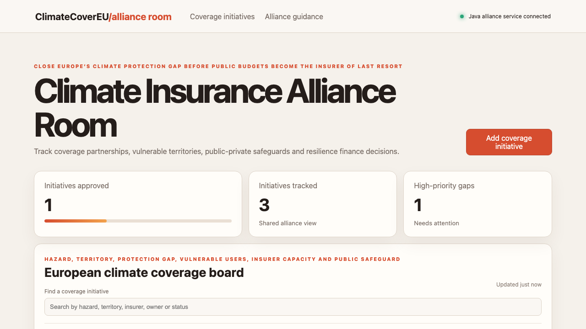

# Climate Insurance Alliance Room

## One-sentence benefit

Help territories, insurers and public authorities close climate protection gaps with accountable coverage initiatives.

## Live demo

[Watch the workflow](docs/demo.webm).

## Screenshots

## Main features

- Search and sort initiatives by hazard, territory, owner or status.
- Create validated initiatives with priorities and accountable teams.
- Advance work through draft, review and approved states.
- Show loading, empty, error and success feedback.
- Present operations and alliance guidance responsively.

## Technology used

Angular, TypeScript, signals, computed state, HttpClient, Vite, Spring Boot and Java 21.

## Installation instructions

Install Node.js 22 and Java 21. Run `npm install`, start `cd backend && mvn spring-boot:run`, then run `npm start`.

## Commercial licensing/contact

Commercial licensing and integration support are available through the repository contact options.

## Business problem and users

Territories, insurers, resilience investors and public authorities need a shared view of protection gaps and prevention-linked coverage.

## Key workflows

Find a climate risk, create a coverage initiative, assign an owner, advance it after review and confirm the API result.

## Angular framework highlights

Signals and computed values drive efficient state, HttpClient handles real writes and built-in control flow renders status-aware actions.

## Java backend highlights

Spring Boot exposes validated list, search, create and update APIs, clear errors, health status and service tests.

## Architecture and state flow

Angular calls `/api/items`; Java validates requests and Angular signals update from returned records.

## Accessibility and responsive behaviour

Semantic landmarks, labelled controls, visible focus states and responsive layouts support keyboard and multiple screen sizes.

## Verification commands

Run `npm test`, `npm run build`, `cd backend && mvn test` and `cd backend && mvn package`.

## Structure

`src` contains the frontend, `backend` contains Java and `docs` contains inspected media.

## Tradeoffs

In-memory records keep setup simple; production needs authentication, persistence and catastrophe-model integrations.

## Roadmap

Add territory risk layers, affordability checks, prevention milestones, claims data and multilingual reports.

